  

# Hi, I'm Matías 👋

**Developer and Systems Analyst** from Argentina. I build software that solves real problems for real businesses, and I run two of my own products in production.

  <picture>
    <source media="(prefers-color-scheme: light)" srcset="https://raw.githubusercontent.com/MatiGimenezD/MatiGimenezD/output/snake-light.svg">
    
  </picture>

## What I've built

- **[SimpleBuy](https://simplebuy.com.ar)**: an e-commerce platform for local stores, with checkout through Mercado Pago. **5,000+ orders processed.** Every change goes through a pull request that runs unit and end-to-end tests; nothing merges unless they pass.
- **[Citax](https://citax.com.ar)**: an AI assistant that books appointments over WhatsApp. **500+ appointments handled with no human intervention**, using message queues, retries and PostgreSQL to keep each conversation's state.
- **Client work**: a reservations and payments system that replaced a club's spreadsheets, and websites for an industrial company and a consultancy.
- **[SIU-Guaraní GPA Calculator](https://github.com/MatiGimenezD/SiuGuaraniPromedio)**: a Chrome extension used by 100+ students.

<table>
  <tr>
    <td width="50%"> <b>SimpleBuy</b>: a real store running on the platform (<a href="https://elgalponcito.simplebuy.com.ar">El Galponcito</a>)</td>
    <td width="50%"> <b>Citax</b>: a client books an appointment over WhatsApp (demo conversation)</td>
  </tr>
</table>

  

## Stack

`JavaScript` `TypeScript` `Node.js` `React` `Python` `SQL` `PostgreSQL` `MongoDB` `AWS` `GitHub Actions` `Playwright`

I also work daily with AI tools and LLM APIs to build and review software.

## Currently

Finishing my Information Systems Engineering degree, researching data analysis with Python and SQL at my university, and building small projects to keep learning.

  

## Contact

- Portfolio: [matigimenezd.github.io/portfolio](https://matigimenezd.github.io/portfolio/)
- LinkedIn: [matias-gimenez](https://www.linkedin.com/in/matias-gimenez-1a7a172bb)
- Email: matiasgimenez452@gmail.com
